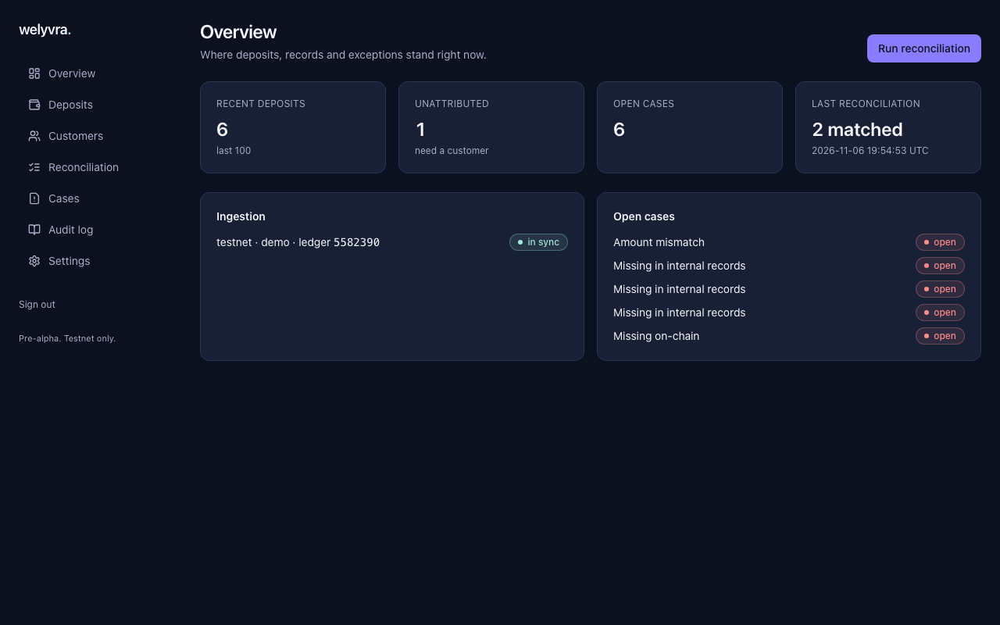

# Welyvra Platform

**Payments move. Records match.**

Welyvra is an open-source reconciliation layer for businesses that receive payments on [Stellar](https://stellar.org). It attributes every deposit to the right customer, records it exactly once in a double-entry ledger, reconciles on-chain activity against internal records, and turns every mismatch into a tracked exception.

> **Status: pre-alpha.** The MVP runs end to end on Stellar **testnet**: ingestion, attribution (memo, `M` and `W` addresses), double-entry ledger, reconciliation, exception cases, API, webhooks and dashboard. It has not been audited and is not production-ready. No mainnet use.

## The problem

A business can receive thousands of payments into one shared Stellar account. Settlement on-chain is correct, but the business still has to:

- identify which customer each deposit belongs to (memo, muxed `M…` address, or — with Protocol 30 — muxed contract `W…` address);
- record each deposit once, even when its indexer restarts or receives an event twice;
- reconcile the chain against its own database and explain every difference;
- investigate unidentified deposits and keep an audit trail.

## What the MVP does

| Component      | Purpose                                                                  |
| -------------- | ------------------------------------------------------------------------ |
| Ingestion      | Idempotent, resumable ingestion of Stellar transfer events               |
| Attribution    | Map memo IDs, `M` and `W` muxed IDs to customers                         |
| Ledger         | Append-only double-entry journal                                         |
| Reconciliation | Match on-chain deposits against internal records; classify discrepancies |
| Exceptions     | Case management for unattributed deposits and mismatches                 |
| API & webhooks | REST API with OpenAPI spec; signed webhooks                              |
| Dashboard      | Operations view for finance and support teams                            |

What Welyvra does **not** do: custody, moving funds, KYC, exchange, tokens. It cannot reverse finalized transactions.

## Try it

See [Getting started](docs/getting-started/README.md): `pnpm demo` reproduces the full flow with real testnet events in about two minutes.

## Documentation

- [Getting started](docs/getting-started/README.md)
- [Project structure](docs/architecture/project-structure.md)
- [Environment variables](docs/deployment/environment-variables.md)
- [Testing](docs/testing/README.md)
- [API reference](docs/api/README.md) and [OpenAPI spec](docs/api/openapi.json)

- [Architecture overview](docs/architecture/overview.md)
- [Stellar integration](docs/architecture/stellar-integration.md)
- [Data model](docs/architecture/data-model.md)
- [Threat model](docs/architecture/threat-model.md)
- [Architecture decision records](docs/adr/)

## Contributing

See [CONTRIBUTING.md](CONTRIBUTING.md). Security issues: [SECURITY.md](SECURITY.md).

## AI assistance

This project is built by a solo founder with AI assistance (Claude Code). AI-assisted commits carry a `Co-Authored-By` trailer, and every change is reviewed by a human before merge.

## License

[Apache-2.0](LICENSE)
